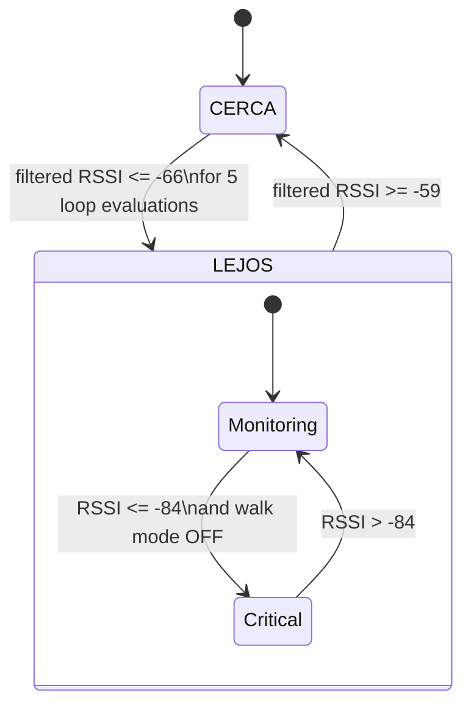
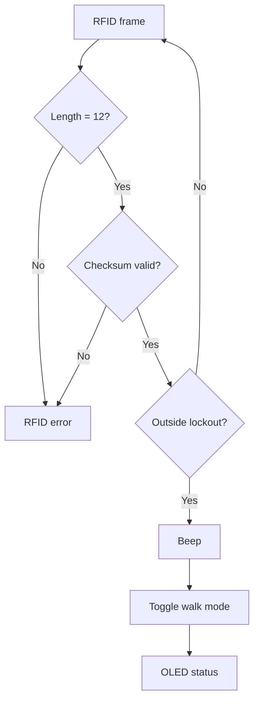
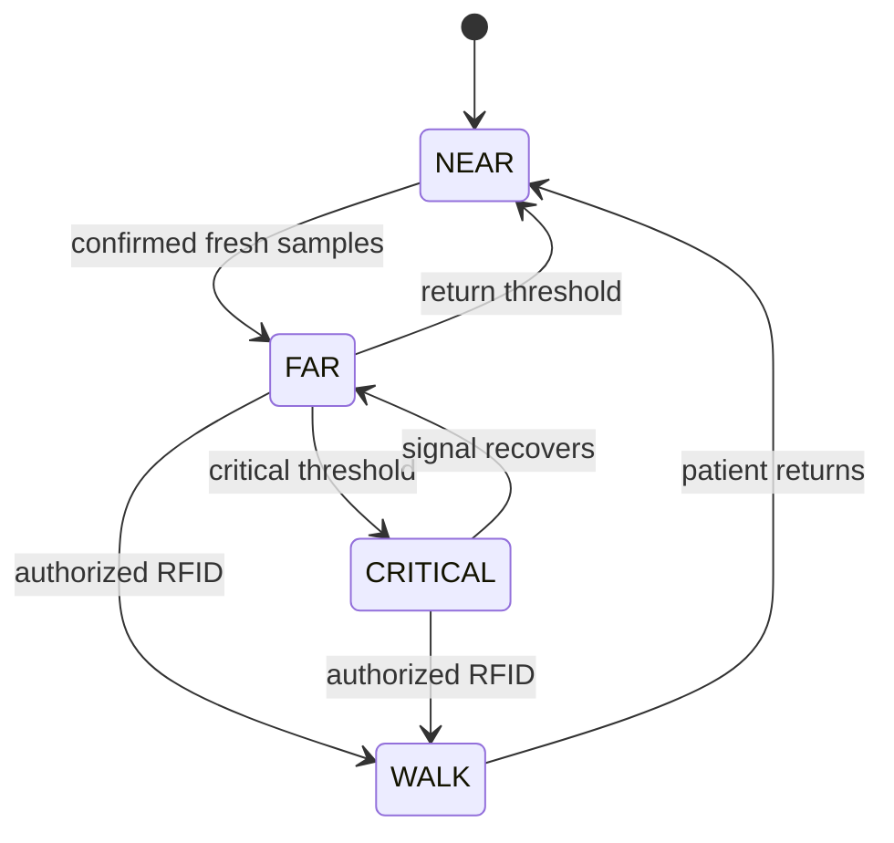

# Area receiver — V1 state-machine review

**Reviewed source:** [area_receiver.ino](../../firmware/public/v1/area_receiver/area_receiver.ino)

The V1 area receiver combines ESP-NOW RSSI processing, a two-state proximity model, a critical-distance alarm, RFID-controlled walk mode, OLED feedback and Arduino IoT Cloud telemetry.

## Main state flow



The thresholds above are historical V1 calibration values from the published snapshot, not universal proximity distances.

## Signal processing

The ESP-NOW callback extracts receive RSSI and applies:

```text
rssi_filtered = 0.20 × rssi_new + 0.80 × rssi_previous
```

The main loop then evaluates the filtered value.

## Hysteresis

The state machine uses:

- `PUNTO_ALERTA = -66`
- `PUNTO_SALIDA = -59`

The 7 dB separation is a deliberate hysteresis mechanism: entering `LEJOS` and returning to `CERCA` do not use the same threshold.

## Departure confirmation

While in `CERCA`, if the filtered RSSI is at or below -66, `contadorLejos` increments. At five counts, the state changes to `LEJOS`.

Important review detail: the counter increments **per main-loop evaluation**, not per newly received packet. This is therefore temporal persistence in the loop, not five independently validated radio frames.

## Critical condition

When:

```text
state == LEJOS
AND walk mode == false
AND filtered RSSI <= -84
```

the historical snapshot:

- drives the red indicator output;
- activates the buzzer;
- shows `DISTANCIA CRITICA` on the OLED;
- publishes `alarmaCritica = true` to the cloud.

## RFID / walk-mode flow

The UART RFID reader uses framed serial data:

- STX (`0x02`) starts a new frame;
- ETX (`0x03`) closes the frame;
- expected payload length is 12 characters;
- the code XORs five decoded bytes and compares the result with the received checksum byte.

When a valid frame is received outside the 1500 ms lockout, walk mode toggles.



## Cloud variables

The receiver publishes:

- filtered RSSI;
- `CERCA` / `LEJOS` state;
- critical-alarm boolean;
- walk-mode boolean;
- distant-patient boolean.

The cloud is therefore a telemetry/status layer. The local state decision itself is made on the receiver.

## Strengths

- Clear `CERCA / LEJOS` state abstraction.
- EMA filtering before decisions.
- Separate enter/exit thresholds provide hysteresis.
- Local alarm remains independent from cloud telemetry.
- RFID parser includes frame-length and checksum validation.
- OLED timing uses `millis()` for normal timed messages.

## Review findings

### Confirmation is not tied to fresh packets

`contadorLejos` can advance multiple times while `rssiFiltrado` still represents the same last packet.

A future version should increment confirmation only when a fresh valid sample arrives.

### No sender or payload validation in ESP-NOW callback

The callback does not verify transmitter identity or packet length before accepting RSSI.

### RFID validates integrity, not authorization

The parser checks frame integrity but does not compare a tag ID with an authorized list in the visible snapshot.

### Alarm outputs are not centralized on every transition

When leaving a critical condition through a state or mode transition, there is no single state-entry function that explicitly assigns every output. A future finite-state implementation should guarantee physical outputs and logical/cloud state cannot diverge.

### Some declarations are unused

The snapshot declares items such as `alarmaSilenciada`, `UMBRAL_CRITICO_SALIDA`, `tiempoAzul`, `azulEncendido` and `rojoActivo` without using them in the visible control path. That is normal residue in an evolving prototype, but should be removed or implemented in a cleaned revision.

### Short blocking delays remain

RFID feedback uses a 160 ms buzzer delay and the loop ends with a 20 ms delay.

## Suggested future explicit states

A later revision could make the hidden substates explicit:



This would make output actions, telemetry and transition testing easier to verify.
