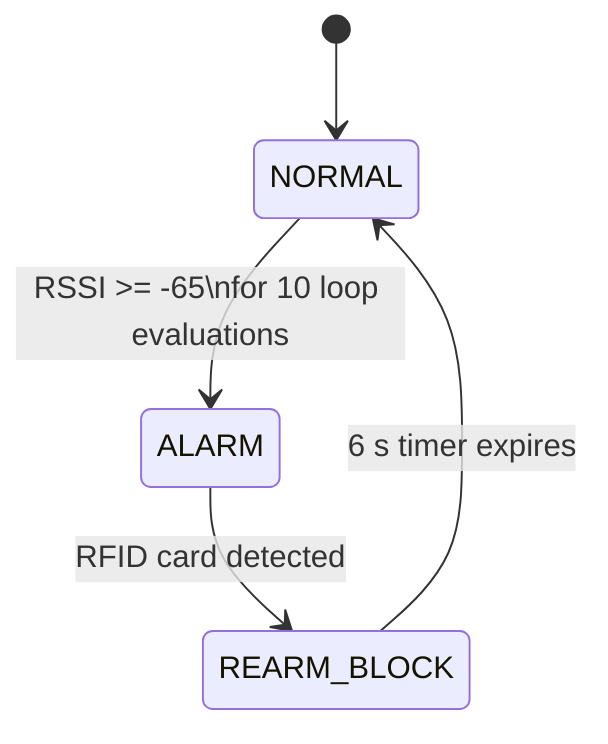
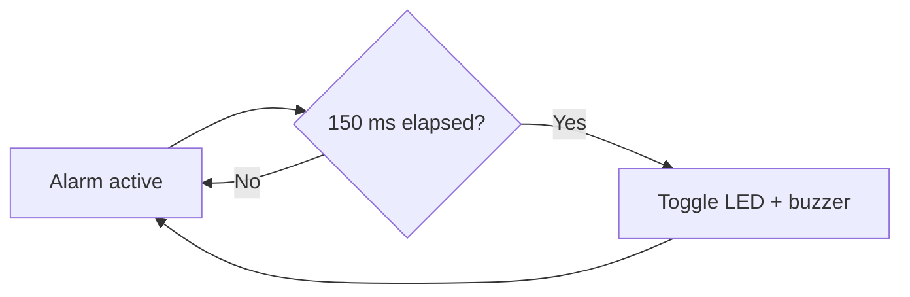
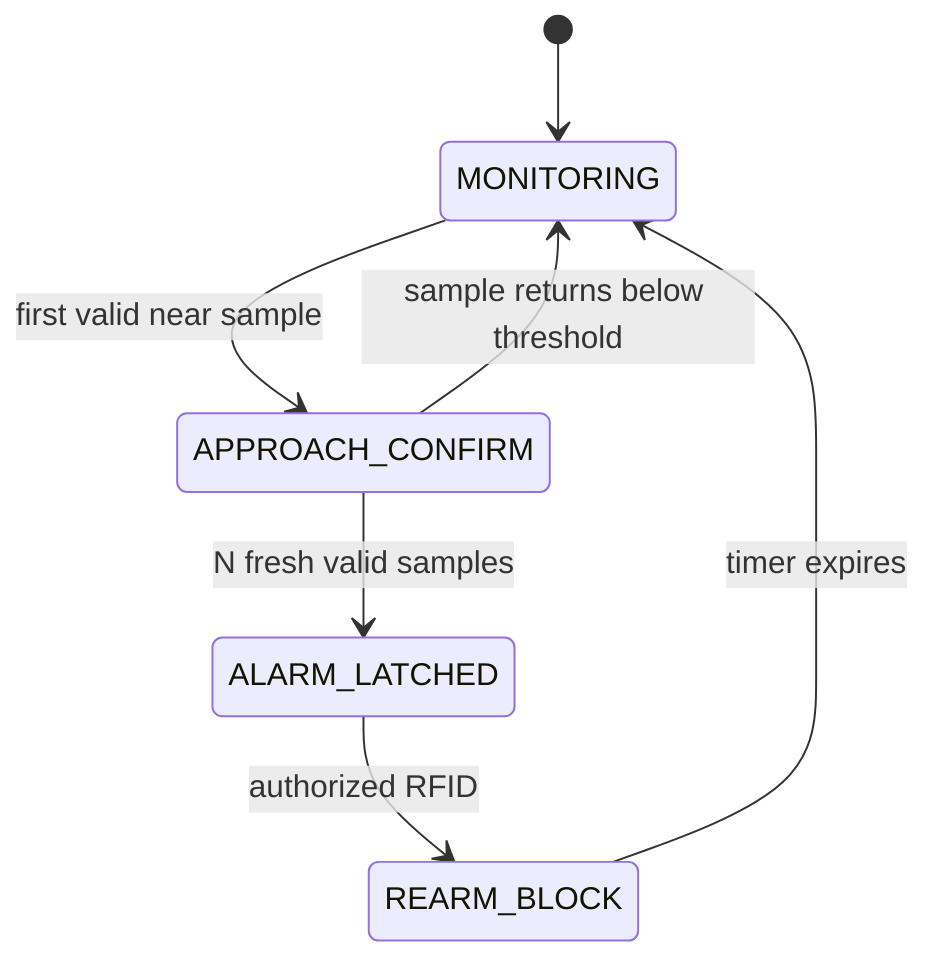

# Exit receiver — V1 state-machine review

**Reviewed source:** [exit_receiver.ino](../../firmware/public/v1/exit_receiver/exit_receiver.ino)

The exit receiver implements an independent approach alarm. It combines filtered ESP-NOW RSSI, a confirmation counter, a latched alarm, PN532 card detection, a timed re-arm block and Arduino IoT Cloud telemetry.

## Behavioral state model

The code does not use an enum, but its booleans create an implicit three-state machine:



## RSSI filtering

The receive callback uses the same EMA form as the area receiver:

```text
rssi_filtered = 0.20 × rssi_new + 0.80 × rssi_previous
```

The historical filtered value starts at -84 dBm.

## Approach confirmation

When the alarm is not active and re-arm is not blocked:

- `rssiFiltrado >= -65` increments `contadorCerca`;
- a lower value resets the counter;
- at `CONFIRMACION_RECEPTOR = 10`, the alarm latches.

As with the area receiver, these ten confirmations are **main-loop evaluations**, not necessarily ten new radio packets.

## Latched alarm behavior

Once `alarmaActiva = true`, the alarm remains active until RFID handling clears it.

The LED and buzzer are toggled every 150 ms with `millis()`, so the main loop is not blocked by the alarm pattern.



This is one of the stronger timing decisions in the V1 code because it preserves loop responsiveness.

## RFID reset and re-arm

The PN532 polls ISO14443A cards with a short 10 ms timeout.

When a card is detected outside the 6000 ms RFID lockout and the alarm is active, the code:

1. clears `alarmaActiva`;
2. resets `contadorCerca`;
3. resets the filtered RSSI baseline to -84;
4. enables `bloqueoRSSI`;
5. sets a six-second re-arm time;
6. shows `ALARMA RESET`.

During the re-arm block, the proximity alarm is not allowed to latch again.

## Cloud variables

The receiver publishes:

- filtered exit RSSI;
- alarm boolean;
- text state `ALERTA` or `NORMAL`.

As in the area receiver, cloud telemetry is downstream of the local decision logic.

## Strengths

- Alarm is explicitly latched rather than directly following noisy RSSI.
- Confirmation counter adds persistence before latching.
- Alarm waveform uses non-blocking timing.
- RFID reset includes a re-arm interval to avoid immediate relatching.
- PN532 polling uses a short timeout to reduce loop blocking.
- Cloud status is derived from the same local alarm state.

## Review findings

### Confirmation is loop-based

One strong filtered RSSI sample can influence several consecutive loop evaluations. Future logic should count fresh packets or use elapsed time based on fresh samples.

### ESP-NOW callback does not validate sender or frame

RSSI is accepted without checking sender identity, payload length or message type.

### Card presence acts as authorization

The code reads a UID but does not compare it with an authorized UID list in the visible snapshot. Any detected ISO14443A card that satisfies the timing condition can participate in the reset workflow.

A future version should implement explicit UID/credential authorization.

### PN532 failure handling can be stronger

If `getFirmwareVersion()` fails, the OLED shows `PN532 ERROR`, but the loop still contains card polling logic. A subsystem health flag would make the degraded state explicit.

### Timer comparison is not rollover-oriented

The re-arm check uses:

```cpp
if (bloqueoRSSI && ahora > tiempoDesbloqueo)
```

For long-running embedded systems, subtraction-based `millis()` comparisons are more robust across timer rollover.

### Callback-to-loop shared state is implicit

`rssiFiltrado` is written in the receive callback and read in the main loop. A future version should make the data-transfer boundary explicit.

## Suggested explicit future states



This makes packet validation, counter behavior, authorization and output actions independently testable.
