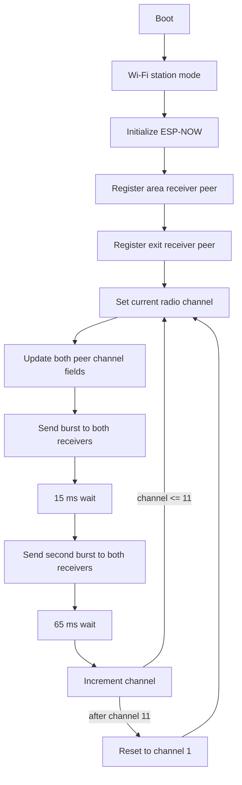
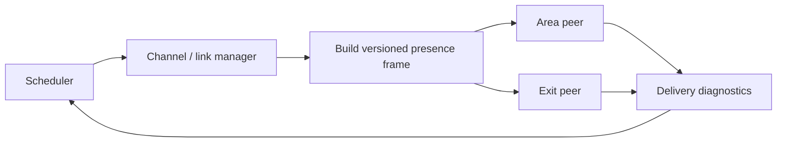

# Wearable transmitter — V1 flow review

**Reviewed source:** [transmitter.ino](../../firmware/public/v1/transmitter/transmitter.ino)

This document describes the behavior visible in the historical V1 transmitter snapshot.

## Control flow



## What the implementation is doing

The transmitter cycles through Wi-Fi channels **1 to 11**. For every active channel it:

1. changes the ESP32 physical radio channel;
2. updates the stored ESP-NOW peer channel for both receivers;
3. sends one frame to each receiver;
4. waits 15 ms;
5. sends a second frame to each receiver;
6. waits 65 ms;
7. advances to the next channel.

The payload is one byte (`dato = 1`). In this implementation, the receivers do not use payload content for proximity; they use the RSSI metadata associated with received ESP-NOW traffic.

## Timing implication

The explicit delay budget per channel is approximately 80 ms.

```text
11 channels × 80 ms ≈ 880 ms per complete sweep
```

Actual time is slightly larger because of API calls and loop overhead.

This gives the V1 transmitter a simple channel-search behavior at the cost of latency and additional airtime.

## Strengths

- Very small application payload.
- Independent transmission to both receivers.
- Dynamic peer-channel update is explicit in code.
- Repeated burst gives each receiver more than one transmission opportunity per visited channel.
- Architecture avoids receiver-to-receiver coordination.

## Review findings

### No send-result callback

The historical snapshot does not register a delivery/send callback and does not inspect the return value from normal `esp_now_send()` calls.

A future implementation should collect per-peer delivery status and diagnostics.

### Peer modification result is not checked

`esp_now_modify_peer()` is called when a peer is found, but its return value is not evaluated.

### Channel strategy is open-loop

The transmitter does not negotiate a channel with either receiver. It sweeps channels continuously.

That is simple and may have been useful during prototyping, but a future revision should compare it with:

- one fixed documented channel;
- channel learned/configured at commissioning;
- controlled channel discovery;
- receiver acknowledgements/health telemetry.

### Blocking timing

The transmitter uses `delay(15)` and `delay(65)` as part of its radio schedule. This is acceptable as a simple single-purpose prototype loop, but it leaves no room for responsive concurrent tasks without restructuring.

## Future transmitter concept



A later version could add a versioned packet structure, sequence counter, sender ID, health flags and transmission diagnostics while keeping the core transmitter responsibility simple.
