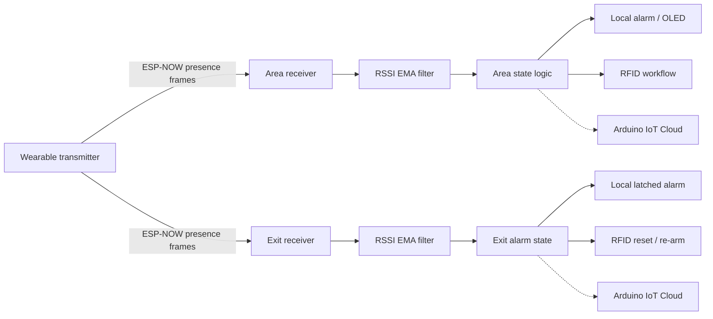
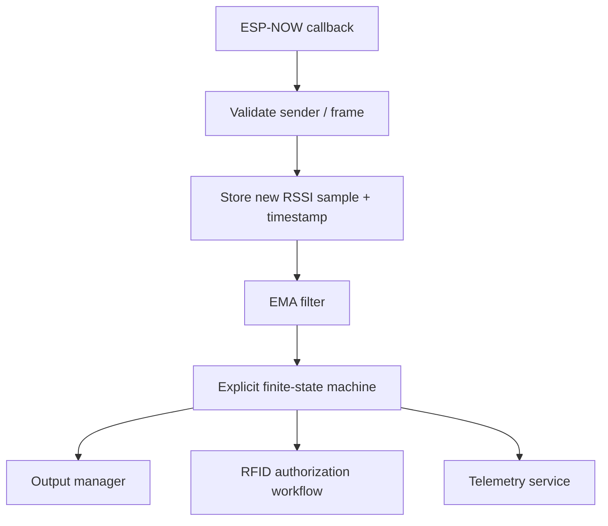

# V1 firmware technical review

This review is a **static engineering review** of the sanitized V1 source snapshots published in this repository. It documents what the code actually does, the design decisions visible in the implementation, and the main improvement opportunities for a future firmware revision.

It does **not** claim that the source was recompiled, flashed, bench-tested or revalidated as part of this review.

## Reviewed source

- [Wearable transmitter](../../firmware/public/v1/transmitter/transmitter.ino)
- [Area receiver](../../firmware/public/v1/area_receiver/area_receiver.ino)
- [Exit receiver](../../firmware/public/v1/exit_receiver/exit_receiver.ino)

## System-level view



The two receivers make local decisions independently. No receiver-to-receiver synchronization is visible in the reviewed source.

## What the V1 firmware demonstrates

The implementation provides concrete evidence of:

- C++/Arduino firmware on ESP32-class devices;
- ESP-NOW peer configuration and receive callbacks;
- RSSI extraction from ESP-NOW receive metadata;
- exponential moving-average filtering;
- hysteresis and state-based proximity decisions;
- UART RFID frame parsing and checksum validation;
- PN532 RFID polling over I²C;
- OLED feedback;
- local LED/buzzer alarm handling;
- Arduino IoT Cloud telemetry;
- non-blocking timing with `millis()` in several workflows;
- iterative prototype-oriented design across three cooperating nodes.

## Strong engineering decisions visible in the code

### Local decision making

Both receivers decide locally from the received RSSI instead of requiring a cloud round trip. That keeps the safety-relevant local alert path separate from telemetry.

### Signal conditioning before state decisions

The receivers use an EMA:

```text
filtered = alpha × new_sample + (1 - alpha) × previous_filtered
```

with `alpha = 0.20` in the historical snapshot. This reduces instantaneous RSSI variation before state evaluation.

### Hysteresis in the area receiver

The area receiver uses different thresholds to enter and leave the distant state:

- enter candidate region: `RSSI <= -66 dBm`;
- return to near state: `RSSI >= -59 dBm`.

This creates a 7 dB hysteresis band and reduces rapid state oscillation around a single threshold.

### Latched exit alarm

The exit receiver does not immediately clear its alarm when RSSI changes. Once the approach condition is confirmed, `alarmaActiva` remains active until the local RFID reset workflow executes.

### More asynchronous alarm handling at the exit

The exit alarm output toggles with `millis()` every 150 ms instead of using a continuous blocking delay, allowing the loop to continue servicing telemetry and RFID polling.

## Review findings

### 1. Confirmation counters are loop-based, not packet-based

In both receivers, the confirmation counters are incremented inside `loop()` from the latest stored filtered RSSI value.

This means:

- `CONFIRMACION_LEJOS = 5` is five loop evaluations, not necessarily five independent received packets;
- `CONFIRMACION_RECEPTOR = 10` is also ten loop evaluations, not necessarily ten independent packets.

A single received sample can therefore continue influencing the counter until a new ESP-NOW packet updates the filter.

**Future improvement:** increment confirmation counters only when a new valid packet has been received, or track a sequence/timestamp associated with each sample.

### 2. ESP-NOW receive callbacks do not validate sender or payload length

The callbacks use `info->rx_ctrl->rssi`, but the historical snapshot does not check:

- sender identity;
- expected payload length;
- expected payload content.

The application therefore treats any accepted ESP-NOW receive callback as a valid proximity sample.

**Future improvement:** validate the transmitter MAC/address, packet version/type and payload length before updating proximity state.

### 3. Radio-channel strategy deserves explicit validation

The transmitter cycles channels 1 through 11. At each channel it updates both peer records and sends two bursts to each receiver.

With the visible delays alone, one full sweep is approximately:

```text
11 × (15 ms + 65 ms) ≈ 880 ms
```

before execution overhead.

The receivers also use Wi-Fi / Arduino IoT Cloud while ESP-NOW depends on the ESP32 radio channel. The reviewed source does not provide enough evidence to prove how channel ownership behaved under every deployed network condition.

**Future improvement:** define one documented radio-channel strategy and validate it while cloud connectivity is active. Record reconnect behavior and packet-loss rate.

### 4. Output handling should be centralized around state transitions

The area receiver drives the critical alarm inside one conditional block. Some transitions, such as returning from `LEJOS` to `CERCA` or entering walk mode, do not explicitly reset every alarm output in a single state-entry function.

The historical behavior may still have worked in the evaluated setup, but the code structure makes it possible for physical outputs and logical/cloud state to diverge after certain transitions.

**Future improvement:** use explicit state-entry actions such as `enterNear()`, `enterFar()`, `enterCritical()` and `enterWalkMode()` that always assign all relevant outputs.

### 5. RFID acceptance is not identity-based in the reviewed snapshot

The area receiver validates the serial RFID frame checksum but does not compare the decoded tag identifier against an authorization list before toggling walk mode.

The exit receiver detects a PN532 ISO14443A card and uses card presence to reset the alarm; it does not compare the UID against an authorized UID list in the visible code.

**Future improvement:** add explicit credential/UID authorization and define the expected behavior for unknown or malformed tags.

### 6. Error handling is prototype-oriented

Examples visible in the code:

- some initialization failures only print/display an error;
- the area receiver continues after an ESP-NOW initialization failure;
- the exit receiver reports a PN532 initialization failure but the main loop still contains PN532 polling logic;
- send/peer modification return values are not checked during normal transmitter operation.

**Future improvement:** use explicit subsystem health flags and a degraded/fault state.

### 7. Configuration is mixed with application logic

Thresholds, GPIO assignments, timing values, cloud declarations and application behavior are kept in the same translation unit.

This is understandable for a prototype but makes calibration, reuse and review harder.

**Future improvement:** separate:

```text
config/
drivers/
services/
application/
```

or an equivalent structure.

### 8. Remaining blocking delays

The area receiver still contains short blocking delays, including the RFID buzzer pulse and the loop delay. The transmitter intentionally uses delays as part of its channel sweep.

**Future improvement:** convert time-sensitive behavior to `millis()`/event-driven scheduling where this improves responsiveness, while preserving measured timing requirements.

### 9. Asynchronous shared state should be made explicit

`rssiFiltrado` is updated from the ESP-NOW receive callback and read from the main loop.

**Future improvement:** isolate callback-to-loop communication through a small sample structure/queue or otherwise document the synchronization model.

## Recommended next firmware architecture

A future revision could separate radio reception from application decisions:



Recommended modules:

```text
src/
├── app/
│   ├── area_fsm.cpp
│   └── exit_fsm.cpp
├── comm/
│   ├── espnow_link.cpp
│   └── cloud_telemetry.cpp
├── drivers/
│   ├── display.cpp
│   ├── alarm_output.cpp
│   └── rfid.cpp
├── signal/
│   └── rssi_filter.cpp
└── config/
    └── system_config.h
```

This is a suggested future architecture, **not a claim about the delivered V1 implementation**.

## Test cases worth adding in a future revision

| Test | Expected observation |
|---|---|
| Valid transmitter packet | RSSI sample accepted and filter updated |
| Unknown sender | Sample rejected |
| Malformed/short payload | Sample rejected |
| RSSI oscillation inside hysteresis band | No rapid state toggling |
| One isolated low-RSSI packet | No false departure confirmation |
| Sustained low RSSI | Area transitions to distant state |
| Sustained critical RSSI | Critical local alarm activates |
| Authorized RFID in walk workflow | Defined walk-mode transition |
| Unknown RFID | No privileged state transition |
| Sustained near RSSI at exit | Exit alarm latches |
| RFID reset at exit | Alarm clears and re-arm interval begins |
| Cloud disconnected | Local monitoring/alarm logic continues |
| millis() rollover | Timers remain correct |

## Conclusion

V1 is valuable portfolio evidence because the firmware is not merely a peripheral demo: it coordinates wireless reception, signal processing, local state decisions, RFID workflows, user feedback and telemetry across multiple nodes.

The most important next step is not to rewrite history, but to use the V1 implementation as a baseline and show how a later revision would improve **packet validation, explicit state machines, authorization, channel management, fault handling and testability**.
