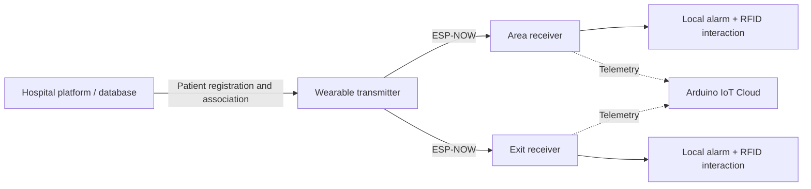

# Firmware architecture

The V1 firmware is documented at two levels:

1. **block-level architecture** for the complete system responsibility split; and
2. **sanitized historical source snapshots** that allow reviewers to inspect representative C++/Arduino implementation without exposing deployment-specific configuration.

## System split

The wearable communicates with each receiver **independently**. The area and exit receivers do not exchange data and do not synchronize state with each other.

## Public node documentation

| Node | Architecture | Sanitized source |
|---|---|---|
| Wearable transmitter | [Logic](transmitter/README.md) | [V1 snapshot](public/v1/transmitter/transmitter.ino) |
| Area receiver | [Logic](area_node/README.md) | [V1 snapshot](public/v1/area_receiver/area_receiver.ino) |
| Exit receiver | [Logic](exit_node/README.md) | [V1 snapshot](public/v1/exit_receiver/exit_receiver.ino) |

## Source availability and boundary

The public snapshots preserve the V1 prototype's main control flow, including ESP-NOW communication, RSSI filtering, state evaluation, RFID interaction, local alarms and Arduino IoT Cloud telemetry.

Deployment credentials and unique device identifiers are excluded from the public files. The original deployment configuration remains private.

These files are historical engineering evidence. They are not presented as production firmware, medical-device software or a reproducible deployment package.

See [public V1 firmware notes](public/v1/README.md) for limitations and review items.

## Technical review

The published V1 source is accompanied by a static engineering review:

- [System-level V1 firmware review](../docs/firmware-review/v1-review.md)
- [Transmitter flow review](../docs/firmware-review/transmitter-flow.md)
- [Area receiver state-machine review](../docs/firmware-review/area-state-machine.md)
- [Exit receiver state-machine review](../docs/firmware-review/exit-state-machine.md)

The review documents strengths, implementation trade-offs and concrete improvement opportunities without rewriting the historical V1 source.
