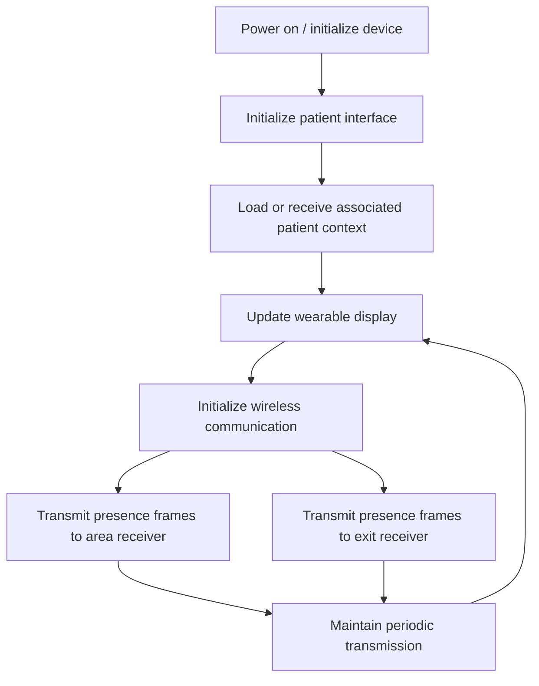

# Wearable transmitter — firmware logic

**Platform:** ESP32-C6 (V1)

The wearable is the patient-side transmitter and includes the user interface used to display the information associated with the patient registered through the hospital platform.

## Responsibility

- Present the patient-associated information on the wearable interface.
- Maintain the patient-side wireless presence signal.
- Communicate independently with the area and exit receivers.
- Avoid receiver-to-receiver coordination; each receiver evaluates the wearable locally.

A sanitized historical V1 source snapshot is available at [public/v1/transmitter/transmitter.ino](../public/v1/transmitter/transmitter.ino). Real deployment-specific peer identifiers are not published.
